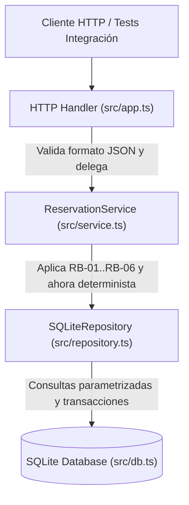
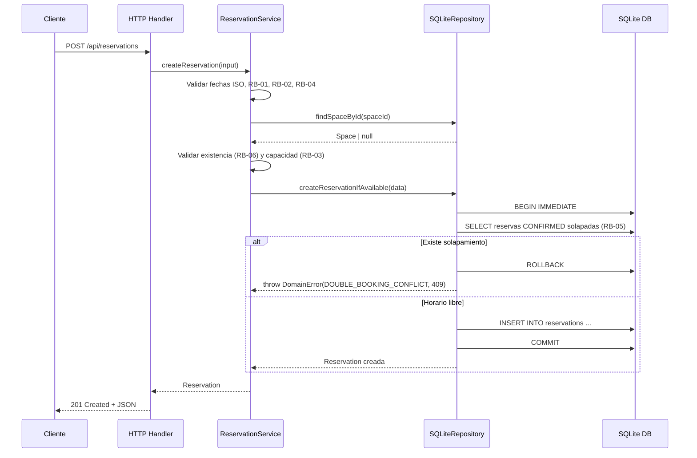

# Arquitectura del Sistema (SDD) — CoworkHub

## 1. Stack Tecnológico Elegido
- **Runtime:** Node.js `v22.23+` (ESM / TypeScript).
- **Lenguaje:** TypeScript `5.x` con modo estricto (`"strict": true`).
- **Persistencia:** SQLite mediante el módulo nativo `node:sqlite` (`DatabaseSync`), garantizando integridad transaccional ACID sin dependencias nativas externas ni compiladores C++.
- **Capa HTTP:** Servidor HTTP REST nativo (`node:http`) sin overhead de frameworks pesados, desacoplado de la lógica de dominio para pruebas directas y por API.
- **Pruebas Automatizadas:** Vitest (`vitest run`).

---

## 2. Arquitectura en Capas

### Responsabilidad por Capa
1. **Capa de Transporte / HTTP Handler (`src/app.ts`):**
   - Parsea rutas y cuerpos JSON.
   - Traduce errores de dominio (`DomainError`) a códigos de estado HTTP consistentes (`400`, `404`, `409`, `422`).
2. **Capa de Servicio / Dominio (`src/service.ts`):**
   - Implementa todas las reglas de negocio (`RB-01` a `RB-06`) de forma pura y determinista.
   - Permite inyectar un proveedor de reloj (`nowProvider: () => Date`) para probar fechas pasadas y ventanas horarias sin depender del reloj real.
3. **Capa de Persistencia (`src/repository.ts` y `src/db.ts`):**
   - Ejecuta sentencias SQL preparadas (`StatementSync`) en transacciones atómicas (`BEGIN IMMEDIATE ... COMMIT`) para prevenir condiciones de carrera en doble reserva.
   - Soporta `:memory:` para pruebas rápidas y aisladas, o ruta a archivo `.db` en ejecución local.

---

## 3. Flujo de Creación de Reserva (Anti-Solapamiento)

