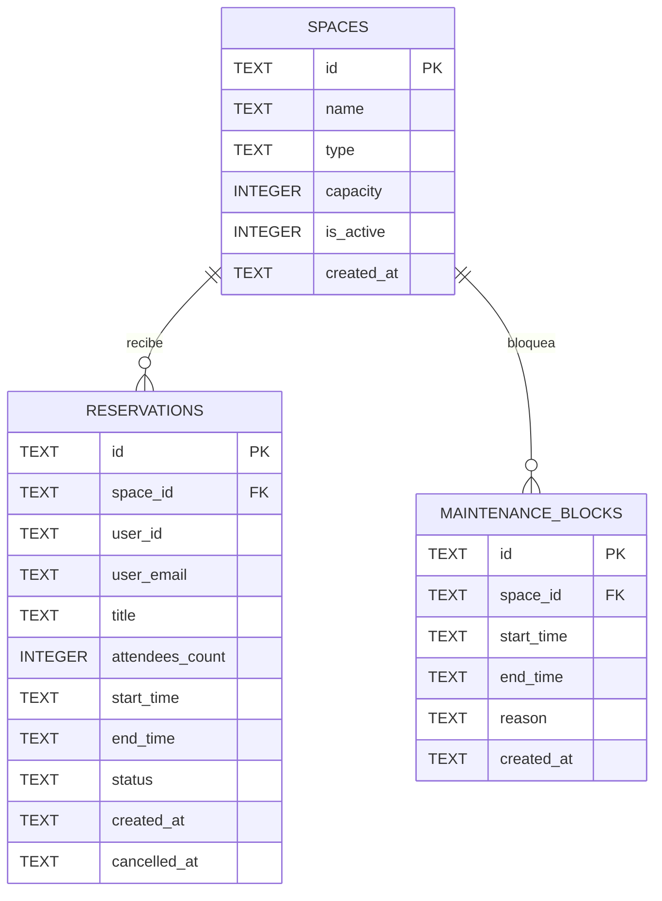

# Modelo de Datos (SDD) — CoworkHub

## 1. Diagrama Entidad-Relación (ER)

---

## 2. Definición de Tablas SQLite

### Tabla `spaces`
Almacena los espacios reservables del coworking.

| Columna | Tipo SQLite | Restricciones | Descripción |
| :--- | :--- | :--- | :--- |
| `id` | `TEXT` | `PRIMARY KEY` | UUID v4 del espacio |
| `name` | `TEXT` | `NOT NULL UNIQUE` | Nombre del espacio (ej. "Sala Innovación") |
| `type` | `TEXT` | `NOT NULL CHECK(type IN ('MEETING_ROOM','PHONE_BOOTH','DEDICATED_DESK','AUDITORIUM'))` | Categoría del espacio |
| `capacity` | `INTEGER` | `NOT NULL CHECK(capacity >= 1)` | Capacidad máxima de asistentes |
| `is_active` | `INTEGER` | `NOT NULL DEFAULT 1` | `1` activo, `0` inactivo |
| `created_at` | `TEXT` | `NOT NULL` | Timestamp ISO 8601 UTC |

### Tabla `reservations`
Almacena las reservas confirmadas y canceladas.

| Columna | Tipo SQLite | Restricciones | Descripción |
| :--- | :--- | :--- | :--- |
| `id` | `TEXT` | `PRIMARY KEY` | UUID v4 de la reserva |
| `space_id` | `TEXT` | `NOT NULL REFERENCES spaces(id) ON DELETE CASCADE` | Espacio reservado |
| `user_id` | `TEXT` | `NOT NULL` | Identificador del usuario |
| `user_email` | `TEXT` | `NOT NULL` | Correo electrónico del solicitante |
| `title` | `TEXT` | `NOT NULL` | Motivo o título de la reunión |
| `attendees_count` | `INTEGER` | `NOT NULL CHECK(attendees_count >= 1)` | Número de asistentes |
| `start_time` | `TEXT` | `NOT NULL` | Inicio en formato ISO 8601 UTC (`YYYY-MM-DDTHH:mm:ss.sssZ`) |
| `end_time` | `TEXT` | `NOT NULL` | Fin en formato ISO 8601 UTC (`YYYY-MM-DDTHH:mm:ss.sssZ`) |
| `status` | `TEXT` | `NOT NULL CHECK(status IN ('CONFIRMED', 'CANCELLED'))` | Estado de la reserva |
| `created_at` | `TEXT` | `NOT NULL` | Timestamp ISO 8601 UTC de creación |
| `cancelled_at` | `TEXT` | `NULL` | Timestamp ISO 8601 UTC de cancelación |

### Tabla `maintenance_blocks` *(Agregada por CR-01 - Ciclo 3)*
Almacena los bloqueos administrativos de mantenimiento sobre espacios.

| Columna | Tipo SQLite | Restricciones | Descripción |
| :--- | :--- | :--- | :--- |
| `id` | `TEXT` | `PRIMARY KEY` | UUID v4 del bloqueo |
| `space_id` | `TEXT` | `NOT NULL REFERENCES spaces(id) ON DELETE CASCADE` | Espacio bloqueado |
| `start_time` | `TEXT` | `NOT NULL` | Inicio del mantenimiento ISO 8601 UTC |
| `end_time` | `TEXT` | `NOT NULL` | Fin del mantenimiento ISO 8601 UTC |
| `reason` | `TEXT` | `NOT NULL` | Motivo operativo del mantenimiento |
| `created_at` | `TEXT` | `NOT NULL` | Timestamp ISO 8601 UTC de creación |

---

## 3. Índices de Optimización
- `idx_reservations_overlap`: índice compuesto sobre `(space_id, status, start_time, end_time)` para acelerar la detección de solapamiento de horarios en `O(log N)` y garantizar respuestas bajo 50 ms (`RNF-02`).
- `idx_maintenance_space_time`: índice compuesto sobre `(space_id, start_time, end_time)` para validar bloqueos de mantenimiento en tiempo logarítmico.
- Al almacenarse las fechas normalizadas en formato ISO 8601 UTC con precisión de milisegundos (`toISOString()`), la comparación lexicográfica en SQLite coincide exactamente con el orden cronológico.
